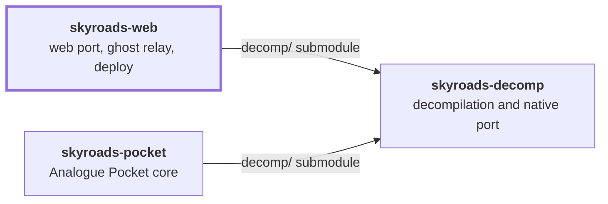

# SkyRoads on the web

This repository is **skyroads-web**. The others: [skyroads-decomp](https://github.com/bertrandom/skyroads-decomp) · [skyroads-pocket](https://github.com/bertrandom/skyroads-pocket).

The browser version of SkyRoads, played at <https://skyroads.org>: the
game's decompiled code built for WebAssembly with Emscripten, with live
ghosts of other players through a small relay, and the script that deploys
both.

| | |
|---|---|
| `web/` | the WebAssembly build and its page (see `web/README.md`) |
| `server/` | the live ghost relay and the nginx sites (see `server/README.md`) |
| `deploy.sh` | build and deploy: staging by default, `./deploy.sh production` for skyroads.org |
| `decomp/` | the decompilation, a git submodule: the game code shared with the native port (`decomp/port`) and the game's files (`decomp/resources/Skyroads`) |

## Building

Needs Emscripten (`emcc`), Python 3 and [uv](https://docs.astral.sh/uv/).

    git submodule update --init   # the decompilation, in decomp/
    make -C web                   # web/dist
    make -C web serve             # http://localhost:8000

The submodule's URL is `../skyroads-decomp`, the decompilation's repository
next to this one; while that is a folder on this machine rather than a
remote, git wants `-c protocol.file.allow=always` on the submodule commands.

The web port's own code in the decompilation (live ghosts in `port/ghost.c`,
signed runs in `port/sign.c`, the page's hooks in `port/sdl/platform.c`, under
`#ifdef __EMSCRIPTEN__`) reaches this build when the submodule is moved to
a newer commit of it.

SkyRoads is © 1993 Bluemoon Interactive, who have made it freeware:
<http://www.bluemoon.ee/history/skyroads/index.html>.
